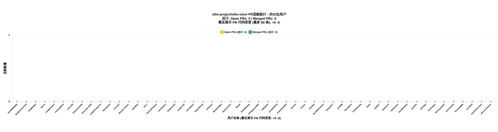

# Enhanced GitHub Stats Report - vllm-project/vllm-omni

Generated on: 2026-11-14 03:58:17 UTC

**统计范围**: vllm-project/vllm-omni 仓库的完整 PR 计数；代码变更统计覆盖最近展示的 最多 80 个 PR。

[vLLM-Omni dashboard](stats_dashboard_vllm_omni.html)

---

这是根据在 **vllm-project/vllm-omni** 仓库中的 PR 贡献（Merged PRs + Open PRs）进行的排序。

总共追踪了 52 个用户；Open/Merged PR 数为完整搜索计数，代码变更统计覆盖最近展示的最多 80 个 PR。

**最近展示 PR 代码变更统计**: +0 行添加, -0 行删除

## 按归属统计

| 归属 | 用户数 | Total PRs | Open PRs | Merged PRs | Recent Additions | Recent Deletions |
| ---- | ------ | --------- | -------- | ---------- | ---------------- | ---------------- |
| HUAWEI | 37 | 0 | 0 | 0 | 0 | 0 |
| 阿里PAI | 3 | 0 | 0 | 0 | 0 | 0 |
| 蚂蚁 | 1 | 0 | 0 | 0 | 0 | 0 |
| 小米 | 1 | 0 | 0 | 0 | 0 | 0 |
| 智谱 | 1 | 0 | 0 | 0 | 0 | 0 |
| Committer | 17 | 0 | 0 | 0 | 0 | 0 |

## Last Release Contributions

_Release contribution stats unavailable. Check the GitHub Actions log for details._

## Current Release Contributions

_Release contribution stats unavailable. Check the GitHub Actions log for details._

### 👤 david6666666 - HUAWEI, Committer - 总贡献: 0
**最近展示 PR 代码变更**: +0 行添加, -0 行删除

**Pull Requests (0 open, 0 merged; up to 10 newest per state shown)**
_No relevant pull requests found._

### 👤 jiangkuaixue123 - HUAWEI - 总贡献: 0
**最近展示 PR 代码变更**: +0 行添加, -0 行删除

**Pull Requests (0 open, 0 merged; up to 10 newest per state shown)**
_No relevant pull requests found._

### 👤 tangtiangu - HUAWEI - 总贡献: 0
**最近展示 PR 代码变更**: +0 行添加, -0 行删除

**Pull Requests (0 open, 0 merged; up to 10 newest per state shown)**
_No relevant pull requests found._

### 👤 bjf-frz - HUAWEI - 总贡献: 0
**最近展示 PR 代码变更**: +0 行添加, -0 行删除

**Pull Requests (0 open, 0 merged; up to 10 newest per state shown)**
_No relevant pull requests found._

### 👤 yangjianjuan - HUAWEI - 总贡献: 0
**最近展示 PR 代码变更**: +0 行添加, -0 行删除

**Pull Requests (0 open, 0 merged; up to 10 newest per state shown)**
_No relevant pull requests found._

### 👤 wuhang2014 - HUAWEI - 总贡献: 0
**最近展示 PR 代码变更**: +0 行添加, -0 行删除

**Pull Requests (0 open, 0 merged; up to 10 newest per state shown)**
_No relevant pull requests found._

### 👤 yenuo26 - HUAWEI - 总贡献: 0
**最近展示 PR 代码变更**: +0 行添加, -0 行删除

**Pull Requests (0 open, 0 merged; up to 10 newest per state shown)**
_No relevant pull requests found._

### 👤 hsliuustc0106 - HUAWEI, Committer - 总贡献: 0
**最近展示 PR 代码变更**: +0 行添加, -0 行删除

**Pull Requests (0 open, 0 merged; up to 10 newest per state shown)**
_No relevant pull requests found._

### 👤 amy-why-3459 - HUAWEI - 总贡献: 0
**最近展示 PR 代码变更**: +0 行添加, -0 行删除

**Pull Requests (0 open, 0 merged; up to 10 newest per state shown)**
_No relevant pull requests found._

### 👤 zengchuang-hw - HUAWEI - 总贡献: 0
**最近展示 PR 代码变更**: +0 行添加, -0 行删除

**Pull Requests (0 open, 0 merged; up to 10 newest per state shown)**
_No relevant pull requests found._

### 👤 Shirley125 - HUAWEI - 总贡献: 0
**最近展示 PR 代码变更**: +0 行添加, -0 行删除

**Pull Requests (0 open, 0 merged; up to 10 newest per state shown)**
_No relevant pull requests found._

### 👤 LJH-LBJ - HUAWEI - 总贡献: 0
**最近展示 PR 代码变更**: +0 行添加, -0 行删除

**Pull Requests (0 open, 0 merged; up to 10 newest per state shown)**
_No relevant pull requests found._

### 👤 Bounty-hunter - HUAWEI - 总贡献: 0
**最近展示 PR 代码变更**: +0 行添加, -0 行删除

**Pull Requests (0 open, 0 merged; up to 10 newest per state shown)**
_No relevant pull requests found._

### 👤 fake0fan - HUAWEI - 总贡献: 0
**最近展示 PR 代码变更**: +0 行添加, -0 行删除

**Pull Requests (0 open, 0 merged; up to 10 newest per state shown)**
_No relevant pull requests found._

### 👤 R2-Y - HUAWEI - 总贡献: 0
**最近展示 PR 代码变更**: +0 行添加, -0 行删除

**Pull Requests (0 open, 0 merged; up to 10 newest per state shown)**
_No relevant pull requests found._

### 👤 natureofnature - HUAWEI - 总贡献: 0
**最近展示 PR 代码变更**: +0 行添加, -0 行删除

**Pull Requests (0 open, 0 merged; up to 10 newest per state shown)**
_No relevant pull requests found._

### 👤 chickeyton - HUAWEI - 总贡献: 0
**最近展示 PR 代码变更**: +0 行添加, -0 行删除

**Pull Requests (0 open, 0 merged; up to 10 newest per state shown)**
_No relevant pull requests found._

### 👤 Gaohan123 - HUAWEI, Committer - 总贡献: 0
**最近展示 PR 代码变更**: +0 行添加, -0 行删除

**Pull Requests (0 open, 0 merged; up to 10 newest per state shown)**
_No relevant pull requests found._

### 👤 congw729 - HUAWEI - 总贡献: 0
**最近展示 PR 代码变更**: +0 行添加, -0 行删除

**Pull Requests (0 open, 0 merged; up to 10 newest per state shown)**
_No relevant pull requests found._

### 👤 herotai214 - HUAWEI - 总贡献: 0
**最近展示 PR 代码变更**: +0 行添加, -0 行删除

**Pull Requests (0 open, 0 merged; up to 10 newest per state shown)**
_No relevant pull requests found._

### 👤 TaffyOfficial - HUAWEI - 总贡献: 0
**最近展示 PR 代码变更**: +0 行添加, -0 行删除

**Pull Requests (0 open, 0 merged; up to 10 newest per state shown)**
_No relevant pull requests found._

### 👤 tzhouam - HUAWEI, Committer - 总贡献: 0
**最近展示 PR 代码变更**: +0 行添加, -0 行删除

**Pull Requests (0 open, 0 merged; up to 10 newest per state shown)**
_No relevant pull requests found._

### 👤 NumberWan - HUAWEI - 总贡献: 0
**最近展示 PR 代码变更**: +0 行添加, -0 行删除

**Pull Requests (0 open, 0 merged; up to 10 newest per state shown)**
_No relevant pull requests found._

### 👤 spencerr221 - HUAWEI - 总贡献: 0
**最近展示 PR 代码变更**: +0 行添加, -0 行删除

**Pull Requests (0 open, 0 merged; up to 10 newest per state shown)**
_No relevant pull requests found._

### 👤 fhfuih - HUAWEI - 总贡献: 0
**最近展示 PR 代码变更**: +0 行添加, -0 行删除

**Pull Requests (0 open, 0 merged; up to 10 newest per state shown)**
_No relevant pull requests found._

### 👤 SamitHuang - HUAWEI, Committer - 总贡献: 0
**最近展示 PR 代码变更**: +0 行添加, -0 行删除

**Pull Requests (0 open, 0 merged; up to 10 newest per state shown)**
_No relevant pull requests found._

### 👤 knlnguyen1802 - HUAWEI - 总贡献: 0
**最近展示 PR 代码变更**: +0 行添加, -0 行删除

**Pull Requests (0 open, 0 merged; up to 10 newest per state shown)**
_No relevant pull requests found._

### 👤 hadipash - HUAWEI - 总贡献: 0
**最近展示 PR 代码变更**: +0 行添加, -0 行删除

**Pull Requests (0 open, 0 merged; up to 10 newest per state shown)**
_No relevant pull requests found._

### 👤 cyr20040123 - HUAWEI - 总贡献: 0
**最近展示 PR 代码变更**: +0 行添加, -0 行删除

**Pull Requests (0 open, 0 merged; up to 10 newest per state shown)**
_No relevant pull requests found._

### 👤 AndyZhou952 - HUAWEI - 总贡献: 0
**最近展示 PR 代码变更**: +0 行添加, -0 行删除

**Pull Requests (0 open, 0 merged; up to 10 newest per state shown)**
_No relevant pull requests found._

### 👤 wtomin - HUAWEI, Committer - 总贡献: 0
**最近展示 PR 代码变更**: +0 行添加, -0 行删除

**Pull Requests (0 open, 0 merged; up to 10 newest per state shown)**
_No relevant pull requests found._

### 👤 mxuax - HUAWEI - 总贡献: 0
**最近展示 PR 代码变更**: +0 行添加, -0 行删除

**Pull Requests (0 open, 0 merged; up to 10 newest per state shown)**
_No relevant pull requests found._

### 👤 zhtmike - HUAWEI - 总贡献: 0
**最近展示 PR 代码变更**: +0 行添加, -0 行删除

**Pull Requests (0 open, 0 merged; up to 10 newest per state shown)**
_No relevant pull requests found._

### 👤 BLANKETusers - HUAWEI - 总贡献: 0
**最近展示 PR 代码变更**: +0 行添加, -0 行删除

**Pull Requests (0 open, 0 merged; up to 10 newest per state shown)**
_No relevant pull requests found._

### 👤 Dong1017 - HUAWEI - 总贡献: 0
**最近展示 PR 代码变更**: +0 行添加, -0 行删除

**Pull Requests (0 open, 0 merged; up to 10 newest per state shown)**
_No relevant pull requests found._

### 👤 psv666 - HUAWEI - 总贡献: 0
**最近展示 PR 代码变更**: +0 行添加, -0 行删除

**Pull Requests (0 open, 0 merged; up to 10 newest per state shown)**
_No relevant pull requests found._

### 👤 ShengDev - HUAWEI - 总贡献: 0
**最近展示 PR 代码变更**: +0 行添加, -0 行删除

**Pull Requests (0 open, 0 merged; up to 10 newest per state shown)**
_No relevant pull requests found._

### 👤 ZeldaHuang - 阿里PAI, Committer - 总贡献: 0
**最近展示 PR 代码变更**: +0 行添加, -0 行删除

**Pull Requests (0 open, 0 merged; up to 10 newest per state shown)**
_No relevant pull requests found._

### 👤 iwzbi - 阿里PAI - 总贡献: 0
**最近展示 PR 代码变更**: +0 行添加, -0 行删除

**Pull Requests (0 open, 0 merged; up to 10 newest per state shown)**
_No relevant pull requests found._

### 👤 Sy0307 - 阿里PAI, Committer - 总贡献: 0
**最近展示 PR 代码变更**: +0 行添加, -0 行删除

**Pull Requests (0 open, 0 merged; up to 10 newest per state shown)**
_No relevant pull requests found._

### 👤 ApsarasX - 蚂蚁 - 总贡献: 0
**最近展示 PR 代码变更**: +0 行添加, -0 行删除

**Pull Requests (0 open, 0 merged; up to 10 newest per state shown)**
_No relevant pull requests found._

### 👤 qibaoyuan - 小米 - 总贡献: 0
**最近展示 PR 代码变更**: +0 行添加, -0 行删除

**Pull Requests (0 open, 0 merged; up to 10 newest per state shown)**
_No relevant pull requests found._

### 👤 JaredforReal - 智谱 - 总贡献: 0
**最近展示 PR 代码变更**: +0 行添加, -0 行删除

**Pull Requests (0 open, 0 merged; up to 10 newest per state shown)**
_No relevant pull requests found._

### 👤 gcanlin - Committer - 总贡献: 0
**最近展示 PR 代码变更**: +0 行添加, -0 行删除

**Pull Requests (0 open, 0 merged; up to 10 newest per state shown)**
_No relevant pull requests found._

### 👤 Isotr0py - Committer - 总贡献: 0
**最近展示 PR 代码变更**: +0 行添加, -0 行删除

**Pull Requests (0 open, 0 merged; up to 10 newest per state shown)**
_No relevant pull requests found._

### 👤 linyueqian - Committer - 总贡献: 0
**最近展示 PR 代码变更**: +0 行添加, -0 行删除

**Pull Requests (0 open, 0 merged; up to 10 newest per state shown)**
_No relevant pull requests found._

### 👤 lishunyang12 - Committer - 总贡献: 0
**最近展示 PR 代码变更**: +0 行添加, -0 行删除

**Pull Requests (0 open, 0 merged; up to 10 newest per state shown)**
_No relevant pull requests found._

### 👤 princepride - Committer - 总贡献: 0
**最近展示 PR 代码变更**: +0 行添加, -0 行删除

**Pull Requests (0 open, 0 merged; up to 10 newest per state shown)**
_No relevant pull requests found._

### 👤 RuixiangMa - Committer - 总贡献: 0
**最近展示 PR 代码变更**: +0 行添加, -0 行删除

**Pull Requests (0 open, 0 merged; up to 10 newest per state shown)**
_No relevant pull requests found._

### 👤 ZJY0516 - Committer - 总贡献: 0
**最近展示 PR 代码变更**: +0 行添加, -0 行删除

**Pull Requests (0 open, 0 merged; up to 10 newest per state shown)**
_No relevant pull requests found._

### 👤 yuanheng-zhao - Committer - 总贡献: 0
**最近展示 PR 代码变更**: +0 行添加, -0 行删除

**Pull Requests (0 open, 0 merged; up to 10 newest per state shown)**
_No relevant pull requests found._

### 👤 alex-jw-brooks - Committer - 总贡献: 0
**最近展示 PR 代码变更**: +0 行添加, -0 行删除

**Pull Requests (0 open, 0 merged; up to 10 newest per state shown)**
_No relevant pull requests found._

